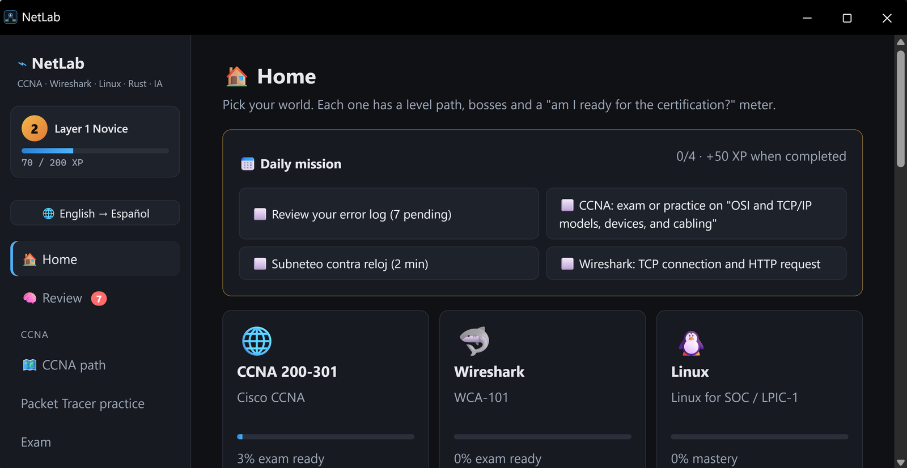
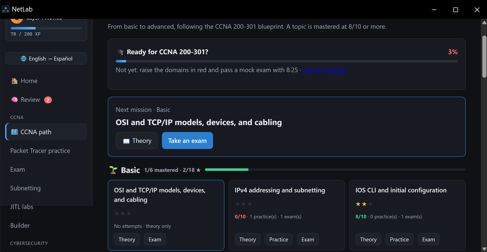
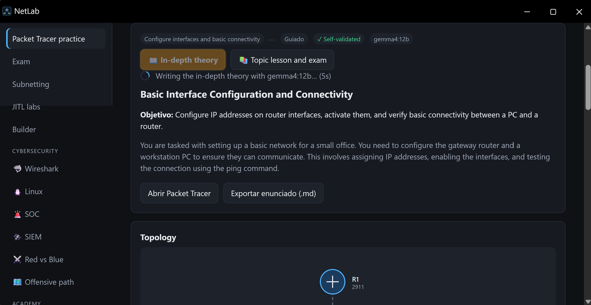
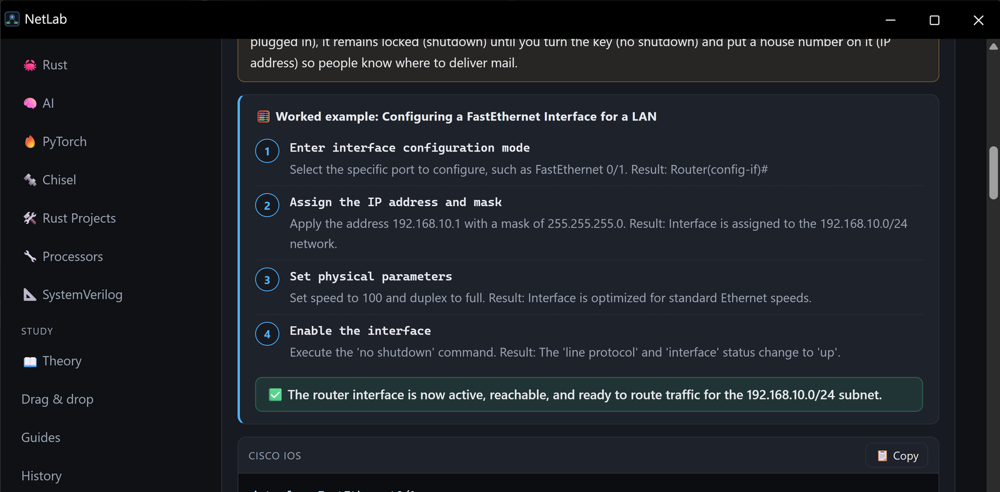
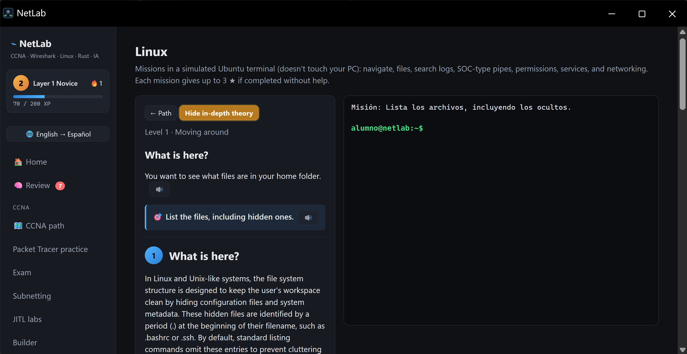

# NetLab

**An AI-powered networking & security lab that runs 100% locally.**
NetLab uses local LLMs (via [Ollama](https://ollama.com)) to generate Cisco Packet Tracer labs, CCNA-style exams and Wireshark exercises, and then **grades your work with deterministic code**, so the AI never decides whether you passed.

> The app UI is available in Spanish and English. The original Spanish documentation is in [`LEEME.md`](LEEME.md).

## Screenshots

| Home | CCNA path |
|---|---|
|  |  |
| **Self-validated Packet Tracer lab** | **Worked example (theory)** |
|  |  |



## Features

- **Packet Tracer lab generator.** Describe a network ("3 routers in a triangle with OSPF…") and get the diagram, addressing plan, configs and a PTBuilder script to build it inside Packet Tracer. Before showing it, the code checks that ports exist on each model, that IPs/ports are not duplicated and that each link joins devices on the same subnet.
- **Automatic grading.** Paste your `show running-config`, `show vlan brief`, `ipconfig` or `ping` output (or a screenshot, read by a vision model) and a deterministic checker grades it. A small model only *explains* the errors and cannot contradict the checker.
- **CCNA 200-301 exams.** Questions are generated by a large model; the model then answers its own questions without seeing the key, and any question where the answers disagree is discarded.
- **Wireshark (WCA-101 style).** 16 capture types in 4 levels (TCP handshake to TLS/SNI, SYN flood, 802.1Q, DNS exfiltration, DHCP starvation…). Each `.pcap` is built by code from a seed, so the answer key comes from the packets, not from the AI. Filters are graded by running them through `tshark`.
- **Linux missions.** A simulated Ubuntu terminal with SOC-style tasks (log hunting, pipelines, permissions, firewall).
- **Red vs Blue.** An AI attacker adapts to your mistakes on Linux, Wireshark and Cisco IOS scenarios; you defend in real time and get a SOC-style report at the end.
- **RAG over your own study material.** Drop PDFs/TXT/MD into `guias/`; NetLab chunks and embeds them with an Ollama embedding model and feeds the relevant parts to the generator.
- **Study system.** Spaced-repetition review of your mistakes, daily missions, XP, levels and a "Am I ready?" meter per CCNA domain.

## How it works

| Part | Who decides |
|---|---|
| Topics and order | Fixed path (CCNA 200-301 syllabus + extras) |
| Writing a lab / exam | Heavy local model (`gpt-oss:20b` by default) |
| Is the generated lab coherent? | Code: its own solution must pass its own checks and the subnets must add up; otherwise it goes back to the model (max. 2 retries) |
| Exam answer key | The model answers its own questions blind; mismatches are discarded |
| Grading your lab | Deterministic code (parses IOS config and command output) |
| Explaining your errors | Light model (`qwen3:4b-instruct`), constrained by the checker's verdict |

## Tech stack

- **Python 3** standard library only for the core app (`http.server`, `sqlite3`, `subprocess`, `threading`), no web framework.
- **Vanilla JavaScript / HTML / CSS** frontend with i18n (ES/EN).
- **Ollama** for local LLMs, vision and embeddings.
- **tshark / dumpcap** for Wireshark exercises, **PTBuilder** for Packet Tracer automation.
- Optional: `pypdf` (reading PDF guides), PyTorch, Rust and Chisel learning modules.

## Project structure

```
app.py          # HTTP server + API, opens the app in its own window
core/           # generators, IOS parser, checker, Wireshark/pcap builder, SIEM, game logic, Ollama client
web/            # frontend (vanilla JS), translations
pruebas/        # tests for the checker (with a fake Ollama)
tools/          # helper scripts
*.ps1           # Windows install / launch scripts
```

## Running it

Requirements: Windows, Python 3.10+, [Ollama](https://ollama.com) with at least one chat model, Cisco Packet Tracer (for labs) and Wireshark (for capture exercises).

```powershell
powershell -ExecutionPolicy Bypass -File .\instalar.ps1
```

### Real Linux / SIEM labs (VirtualBox) and Hyper-V

Most of NetLab works out of the box. The labs that run on a **real Ubuntu VM** (real Linux missions, the SIEM with Elasticsearch + Kibana, and the local attack target) need [VirtualBox](https://www.virtualbox.org), and they run much better with **Hyper-V turned off**:

- **Hyper-V on:** VirtualBox falls back to its slow NEM mode. NetLab detects it and limits the VM to 1 CPU core so it doesn't freeze, but booting and the SIEM are very slow.
- **Hyper-V off:** VirtualBox uses VT-x/AMD-V directly and the SIEM VM gets 6 cores.

Turn it off (PowerShell **as Administrator**, then restart Windows):

```powershell
bcdedit /set hypervisorlaunchtype off
```

Check after the restart (`False` means it is off):

```powershell
(Get-CimInstance Win32_ComputerSystem).HypervisorPresent
```

To turn it back on: `bcdedit /set hypervisorlaunchtype auto` and restart.

Notes:
- While Hyper-V is off, **WSL 2, Docker Desktop and Windows Sandbox won't work**.
- If `HypervisorPresent` is still `True`, also disable *Core isolation → Memory integrity* in Windows Security and restart.
- Virtualization (Intel VT-x / AMD-V / SVM) must be enabled in the BIOS/UEFI.
- The SIEM VM uses 16 GB of RAM; the regular Linux VM uses 2 GB. When NetLab closes, the VM is paused to disk (~the size of its RAM).
- If you switch Hyper-V on/off, the VM's saved state is discarded and it cold-boots once (this is expected).

Tests:

```powershell
python -B -m pruebas.test_checker
```

## Privacy

Everything runs on your machine. Only `datos/` (history, embeddings, config) is written, and temporary capture files are deleted when the app closes.
